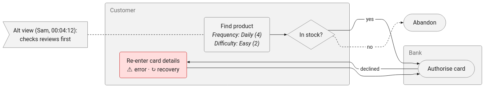
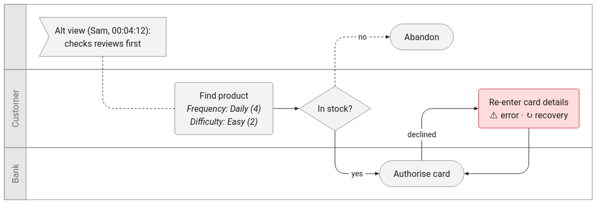

# 10 — Proof of Technology

Status: **Draft** · Last updated: 2026-10-18 · Timebox: **2–3 days** · Ends in: **go / conditional go / no-go**

## Purpose

Before building the PoC, prove that the two technologies it depends on can do the job:

- **Part A, Rendering (pele):** can a Task Flow Model be drawn as a legible, standalone SVG
  showing everything the [vision](00-vision.md#what-the-diagram-captures) requires?
- **Part B, Extraction (Claude):** can Claude turn a VTT transcript into a faithful,
  schema-valid Task Flow Model that follows the
  [interpretation rules](00-vision.md#transcript-interpretation-rules)?

Each check has an ID (`PT-xx` for rendering, `PE-xx` for extraction). Automatable checks
become tests named after their ID (e.g. `test('PT-10: escapes quotes in step labels')`).
Judgement checks are recorded by a reviewer in the [results table](#results).

## Fixtures

Real transcripts will come later ([vision](00-vision.md#constraints--assumptions)), so the PoT
uses **synthetic** fixtures in `tests/fixtures/`. Each has a VTT file and a hand-written
**reference Task Flow Model** (the expected answer).

| ID | Transcript | Exercises |
|---|---|---|
| F1 | Single participant, short linear task | Baseline: actor, goal, steps, flow |
| F2 | Single participant with branches, errors and retries | Decisions, error flows (one returning to the main flow, one ending the task), attempts, outcomes and their frequency, threshold judgements |
| F3 | Two people on one connection who agree | Shared speaker label, consensus |
| F4 | Two participants who do the task differently | Divergence: main speaker's flow + timestamped alternative view |
| F5 | Interviewer asks for scales on some steps, not others | Scale vs free text, scale preferred, inferred values marked, questions excluded |
| F6 | Long interview, 30–60 steps, 3–5 actors, told non-linearly | Size, time, cost, legibility at scale; non-linear telling at scale |
| F7 | Text with quotes, brackets, `<` `>`, `&`, emoji, accented names | Escaping and robustness |
| F8 | Single participant who tells the task out of order: jumps ahead, goes back, adds detail later, corrects themselves | Non-linear accounts: task order, merged late detail, corrections |
| F9 | Single participant with repeated and iterated steps | Repeat with a known count (later corrected), "for each" repeat nested inside it, iteration with typical passes and a limit that triggers an error flow |

The fixtures are in `tests/fixtures/` (see its README); unit tests check every expected
result against the schema and semantic rules. **F6 is about 6 minutes of dialogue** with
33 steps: large enough for rendering checks (PT-08), but the 60-minute target in PE-06
needs a real transcript.

## Part A: Rendering (pele)

### Initial findings (2026-10-18)

The same small flow (2 actors, a decision, an error/recovery loop, an outcome, an
annotation) rendered both ways in Firefox:

| `flowchart` | `swimlane-beta` |
|---|---|
|  |  |

- **`swimlane-beta` is clearly more legible:** real lanes per actor, branch labels sit next
  to their edges, the error loop is easy to follow.
- **`flowchart` is ambiguous:** the `yes` and `no` edges cross, and `yes` appears next to the
  wrong target. Actor groups read as boxes, not lanes.
- `swimlane-beta` uses the **same syntax as `flowchart`** (subgraphs become lanes) with a
  different header and layout, so switching between them costs one line.
- In both, **nodes not assigned to a lane** (the outcome and the annotation) end up in an
  unlabelled area. The compiler must assign every node to a lane.
- Multi-line labels, italics, `classDef` styling, the note shape and loop-back edges all work.
- Parse errors report a line number (`Parse error on line 3`).
- The SVG embeds default colours and renders correctly in a page without pele's CSS,
  which suggests it works as a standalone file (see PT-14).

These are a first look, not results. The checks below confirm or refute them.

### Checks

| ID | Question | Method | Pass when |
|---|---|---|---|
| PT-01 | Which diagram type: `swimlane-beta` or `flowchart`? | Render F1–F6 reference models both ways; reviewer compares | One type renders all fixtures legibly; choice recorded in decisions |
| PT-02 | Does each actor get a lane, with every node inside one? | Render F2–F4, F6; inspect | One labelled lane per actor; no unlabelled area; outcomes and notes placed deliberately |
| PT-03 | Are decisions and their branches unambiguous? | Render F2, F6; reviewer traces each branch | Every branch label is next to the edge it belongs to; no misreadings |
| PT-04 | Can step properties be shown inside a step? | Render F5: Likert label + value, quote-only values, inferred values | Scale shown as label and value (e.g. *Difficulty: Hard (4)*); inferred values visibly marked; text fits |
| PT-05 | Can all completion metrics be shown? | Render F2 | Success / failure / abandonment outcomes distinguishable, with their frequency; time on task and attempts visible |
| PT-06 | Do annotations stay attached to their step? | Render F4, F6; try note node in same lane, edge label, tooltip | Each annotation is visibly linked to and near its step; alternative views show speaker and timestamp |
| PT-07 | Can evidence (cue IDs, timestamps) travel in the SVG without clutter? | Try tooltips, `<title>`, links, data attributes | Every element can carry its cue references; hidden or unobtrusive by default |
| PT-08 | Does it hold up at realistic size? | Render F6 (30–60 steps, 3–5 actors) | Legible at a sensible zoom; render < 1 s in Node; within pele's limits (`maxEdges`, `outputLimit`), raising them if needed |
| PT-09 | Can styling encode difficulty and outcome? | Style the 5 difficulty levels and 3 outcomes via `classDef` / CSS variables | Distinguishable in colour and without colour (e.g. border weight, icon); readable in light and dark |
| PT-10 | Is text escaped safely? | Compile F7; automated test | No parse errors; text appears exactly as spoken; no markup injected |
| PT-11 | Is output deterministic? | Render the same model 10 times; automated test | Byte-identical SVG every time |
| PT-12 | Do Node and browser output match? | Render F2 with `render()` in Node and `mount()` in Firefox | Same structure and content; any layout differences understood (e.g. `responsive`, `maxWidth`) |
| PT-13 | Can pele be replaced if needed? | Review: does `swimlane-beta` tie us to pele? Is a fallback viable? | Renderer sits behind `renderTaskFlow(model) → svg`; `flowchart` (standard Mermaid 12.1) confirmed as fallback |
| PT-14 | Is the SVG a usable standalone file? | Open CLI output directly in Firefox, Chrome and Inkscape | Correct colours and fonts with no external CSS; text selectable |
| PT-15 | Can error flows follow the [visual standard](30-design.md#visual-standard-for-error-links)? | Render F2's main flow and error flows to one directory; open in Firefox and follow the links | Link-out, entry, return and re-entry connectors use the standard shapes and styles, sit in the right lane, and their relative links open the matching diagram |
| PT-16 | Can threshold judgements be shown? | Render F2 with `above` and `below` measures | `above` shows a clear frustration marker; `below` doesn't clutter the diagram |
| PT-17 | Can loops be shown? | Render F8 and F9 | Repeat and iteration markers follow CM-12; nested loops readable; the iteration limit links to its error flow |

## Part B: Extraction (Claude)

Uses the official Anthropic SDK, model `claude-opus-5-5`, with **structured outputs**
(`output_config.format`) to constrain the response to the Task Flow Model JSON Schema.

| ID | Question | Method | Pass when |
|---|---|---|---|
| PE-01 | Is the output always schema-valid? | Run F1–F6, 3 times each | 100% valid against the schema |
| PE-02 | Is it faithful? | Compare to reference models; check every cue reference resolves | No invented steps; every element cites existing cues that support it |
| PE-03 | Does it cover the transcript? | Compare steps to reference models | ≥ 90% of reference steps present (vision criterion 1) |
| PE-04 | Does it follow the interpretation rules? | F3, F4, F5 | Questions excluded; consensus used; divergence as main speaker + timestamped annotation; scale preferred; inferred scales marked; time on task from speech |
| PE-05 | Is it consistent between runs? | F2 and F6, 3 runs each | Same actors, goal, decisions and outcomes; step count varies by ≤ 10% |
| PE-06 | Does it fit the size, time and cost limits? | F6 | Within context window; end-to-end < 3 min; cost per transcript recorded |
| PE-07 | Are failures handled? | Malformed VTT; empty transcript; refusal or `max_tokens` stop reasons | Clear error, no partial or invalid model written |
| PE-08 | Does it handle non-linear accounts? | F8 | Steps in task order, not telling order; late details merged into existing steps (no duplicates); corrected versions used, each with a correction annotation |
| PE-09 | Does it recognise repetition? | F8, F9 | Repeats with count (number or text), iterations with pass/fail, typical passes and limit; limit linked to an error flow; every cycle declared |

**Rough cost estimate:** a 60-minute interview is about 10–15k words (≈ 20k tokens). With
instructions and schema, input is ≈ 25k tokens and output perhaps 5–15k including thinking.
At current `claude-opus-5-5` prices ($4 / $20 per million tokens) that is roughly
**$0.20–0.40 per transcript**. PE-06 replaces this estimate with measured figures.

## Go / no-go

- **Go:** PT-01 to PT-07, PT-10, PT-11, PT-13 to PT-15, PE-01 to PE-04 and PE-08 pass.
- **Conditional go:** a failure has a workaround that fits the timebox (e.g. annotations
  as tooltips instead of note nodes). The workaround is recorded in decisions.
- **No-go on pele:** lanes with unambiguous decisions can't be drawn legibly, output isn't
  deterministic, or the SVG isn't usable standalone. Fallbacks to evaluate:
  Graphviz (`dot` clusters as lanes) or the official Mermaid renderer (needs a headless browser).
- **No-go on extraction:** PE-01 or PE-02 fail and prompt or schema changes don't fix
  them within the timebox. Revisit the approach (e.g. chunking, two-pass extraction,
  human-in-the-loop review) before the PoC.

## Out of scope for the PoT

- The OpenAPI contract and adapters (CLI/HTTP): PoC work, after go.
- Final visual design and theming.
- Real transcripts: re-run Part B on them when they arrive.

## Results

| ID | Result | Date | Notes |
|---|---|---|---|
| PT-01 | Awaiting review | 2026-10-18 | Compiler uses `swimlane-beta`; all fixtures render (`npm run render:fixtures -- --screenshots`, output in `out/fixtures/`). Reviewer to confirm against `flowchart` |
| PT-02 | **Pass** | 2026-10-18 | Automated: every node in every fixture diagram is declared in a lane; pele parses all output |
| PT-03 | Awaiting review | 2026-10-18 | Branch labels sit beside their edges in F2, F7, F8; some long edges cross lanes in F6 |
| PT-04 | **Pass** | 2026-10-18 | Automated: Likert label + value, `*` for inferred, quotes for text-only, attributes, states, time, attempts |
| PT-05 | Awaiting review | 2026-10-18 | Outcome classes automated (success/failure/abandonment borders); outcome frequency shown in node |
| PT-06 | Awaiting review | 2026-10-18 | Flags sit in the target's lane joined by a dotted line; in F6 they add noticeable bulk |
| PT-07 | Not started | | Cue references are not yet carried into the SVG |
| PT-08 | Partial | 2026-10-18 | F6 renders in < 10 ms (automated < 1 s). Legibility at 33 steps needs review: LR layout is very wide; options are TB direction, `detail: 'summary'`, or hiding annotation kinds |
| PT-09 | Awaiting review | 2026-10-18 | Carbon theme (White / Gray 100) via CSS (D-017, D-018); difficulty fill 1–5, frustration = orange 3px border + ▲, outcomes by border colour and dash; values also in text. Light and dark screenshots generated |
| PT-10 | **Pass** | 2026-10-18 | Automated: every F7 label, condition, annotation and the title render exactly as written |
| PT-11 | **Pass** | 2026-10-18 | Automated: repeated renders of F6 are byte-identical |
| PT-12 | Not started | | |
| PT-13 | Partial | 2026-10-18 | pele used only in `src/render/render.js`. Risk: edge styling relies on pele's edge `data-id` format |
| PT-14 | Partial | 2026-10-18 | Firefox (automated): standalone file gets the Carbon theme with no external CSS. Chrome and Inkscape not yet checked |
| PT-15 | **Pass** | 2026-10-18 | Automated: link-out/entry hexagons and return/re-entry double circles, in the right lanes, with relative links both ways. Visually confirmed in F2 |
| PT-16 | **Pass** | 2026-10-18 | Automated: `above` shows ▲ and the `frustration` class; `below` shows nothing |
| PT-17 | **Pass** | 2026-10-18 | Automated: repeat (× n and for-each) and iteration markers per CM-12, back edge routed through the marker, limit linked to its error flow, loop colour in Firefox. Nested loops in F9 readable; reviewer to confirm |
| PE-01 to PE-09 | Pending | | Schema and fixtures ready; needs API credentials |
