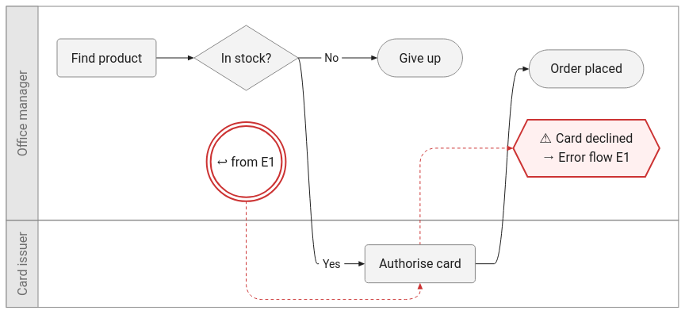
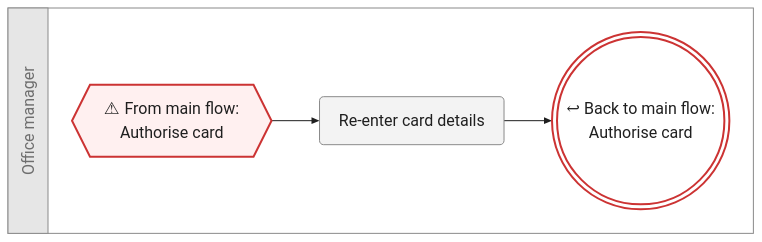

# 30 — Design

Status: **Draft** · Last updated: 2026-10-18

This document grows as the design firms up. It currently covers the **Task Flow Model**,
which is needed first by the [Proof of Technology](10-pot.md), the **visual standard** for
error flows, and the first **API** notes.

## Task Flow Model

The Task Flow Model is the core artefact (D-006): Claude produces it, the API validates
and stores it, and renderers draw it.

- **Schema:** [`schemas/task-flow.schema.json`](../schemas/task-flow.schema.json) (JSON Schema 2020-12)
- **Worked example:** [`schemas/examples/checkout.flow.json`](../schemas/examples/checkout.flow.json)
- **Version:** `0.1.0` (`schemaVersion`). Breaking changes bump the minor version until 1.0.

### Document structure

| Part | Produced by | Contents |
|---|---|---|
| `source` | API | **Fully qualified path** to the VTT file, its SHA-256 at extraction time, cue count, duration (D-015) |
| `extraction` | API | Model used, timestamp, options (`mainSpeaker`, `interviewers`) |
| `cues` | API (VTT parser) | Timing index: cue ID, start, end, speaker. **No text**: the text stays in the VTT file at `source.path` |
| `flow` | **Claude** | The extracted task flow; `$defs/flow` is the structured-output schema |

The SHA-256 lets the API detect that the VTT file has changed since extraction, in which
case cue references may no longer match.

### `flow` contents

| Element | Maps to vision concept | Notes |
|---|---|---|
| `title`, `goal` | Goal | |
| `participants` | Speakers | How each VTT speaker label was interpreted: interviewer / participant, main speaker, shared connection, people heard under the label |
| `actors` | Actor | Anyone who performs a step, including organisations and systems that are only talked about. Linked to speaker labels where they spoke. Shared by the main flow and error flows |
| `steps` | Step, Conditionality, Outcomes | `kind`: `action`, `decision` (label is the question), `outcome` (`outcome`: success / failure / abandonment), or `return` (error flows only) |
| `steps[].frequency`, `.difficulty` | Step properties | `measure` (see below). On an outcome, `frequency` is how often the task ends that way |
| `steps[].attributes`, `.states` | Step properties | Name/value pairs. **Attributes** describe the step (*Tool: Supplier website*); **states** describe the condition of something at that step (*Payment: Declined*) (D-012) |
| `steps[].metrics`, `flow.metrics` | Completion metrics | `timeOnTask` (as stated, in minutes + quote) and `attempts`, per step and for the whole task |
| `transitions` | Flow, Conditionality | `condition` labels branches out of decisions |
| `errorFlows` | Completion metrics (errors and recovery) | Separate flows followed when something goes wrong (see [Error flows](#error-flows)) |
| `annotations` | Annotations | `kind`: note, hesitation, workaround, opinion, quote, `alternativeView` (D-004). Attached to any step, transition, actor or error flow, or to the whole task (`targetId: null`) |
| every `evidence` | Evidence | Cue IDs that support the element |

IDs are unique across the whole document, including error flows, so any element can be
referenced unambiguously.

### Measures

```json
{ "value": 4, "basis": "scale", "threshold": null, "text": "I'd say a four, it's a real pain", "evidence": ["c8", "c9"] }
```

| `basis` | Meaning | `value` | Display |
|---|---|---|---|
| `scale` | Participant gave a scale value, spontaneously or when asked | 1–5 | Label + value, e.g. *Difficulty: Hard (4)* |
| `inferred` | Free text only; the extractor mapped it to the scale | 1–5 | Label + value, marked as inferred, e.g. *Difficulty: Easy (2)\** |
| `text` | Free text that can't be sensibly mapped | `null` | The quote |

When a participant gives both a scale value and free text for the same item, `basis` is
`scale` and `text` keeps the free text (D-003). **Labels are not stored**: they are derived
from `value` using the scales in the [vision](00-vision.md#scales), so they can't drift.

#### Threshold judgements

Participants often judge frequency or difficulty in **binary** terms against a tolerance
of their own that they rarely state: *"it doesn't happen often enough to bother me"* versus
*"it happens way too often"*. The threshold itself is vague; which side of it the
participant puts something on is the useful signal (D-014).

| `threshold` | Meaning | Display |
|---|---|---|
| `above` | Beyond the participant's tolerance: a **frustration signal** | Frustration marker on the element |
| `below` | Within tolerance: not a concern | Shown only in detail views |
| `null` | No binary judgement was expressed | — |

`threshold` is independent of `value`: a measure can have a scale value, a threshold
judgement, both, or neither (text only).

### Error flows

Errors are modelled as **separate flows**, each rendered as **its own diagram** (D-013).

```
main flow                                      error flow E1 ("Card declined")
─────────                                      ───────────────────────────────
[Authorise card] ┄┄► ⬡ ⚠ Card declined  ──────► ⬡ ⚠ From main flow: Authorise card
                       → Error flow E1                       │
                                                     [Re-enter card details]
       ▲                                                     │
       ┆                                                     ▼
   ◎ ↩ from E1  ◄──────────────────────────────── ◎ ↩ Back to main flow: Authorise card
```

- An error flow has one or more **triggers**: the main-flow step where the error occurs,
  what goes wrong (`condition`), and how often (`frequency`, including `threshold`).
- It has its own steps and transitions, starting at `startStepId`.
- It ends in **outcomes** (the task ends there) and/or **return steps**. A return step's
  `returnToStepId` names the main-flow step where the task continues.
- Error flows can't trigger other error flows in this version (keeps the schema
  non-recursive and the diagrams one level deep).

### Visual standard for error links

| Element | Appears on | Shape | Content | Style | Link |
|---|---|---|---|---|---|
| **Error link-out** | Main diagram, next to the trigger step | Hexagon | `⚠ <condition>` / `→ Error flow <id>` | Red border, light red fill; dashed red edge from the step | Opens the error flow's diagram |
| **Error entry** | Error diagram, at the start | Hexagon (same as link-out) | `⚠ From main flow: <trigger step label>` | Same as link-out | Opens the main diagram |
| **Error return** | Error diagram, at each return step | Double circle | `↩ Back to main flow: <target step label>` | Red double border, white fill | Opens the main diagram |
| **Error re-entry** | Main diagram, next to the step it comes back in to | Double circle (same as return) | `↩ from <error flow id>` | Same as return; dashed red edge **into the target step** | Opens the error flow's diagram |

Rules:

- Connector nodes sit in the **same lane** as the step they attach to.
- Pairs use the same shape on both diagrams (hexagon for out/entry, double circle for
  return/re-entry), so the reader can match them up.
- The hexagon and double-circle shapes are reserved for error links; annotations use the
  flag shape.

Initial rendering of this standard (see PT-15):

| Main diagram | Error flow diagram |
|---|---|
|  |  |

### Output files

Rendering produces one SVG for the main flow and one per error flow, **always written to
the same directory**:

| File | Contents |
|---|---|
| `<name>.svg` | Main flow |
| `<name>.error-<id>.svg` | Error flow `<id>`, e.g. `checkout.error-E1.svg` |

Because they share a directory, the connector links are **relative file names**
(e.g. `href="checkout.error-E1.svg"`). pele passes relative links through unchanged
(checked 2026-10-18).

### Evidence and timestamps

- The VTT parser gives every cue a stable ID (`c1`, `c2`, …) and sends Claude the cues as
  `[c12 00:04:12 Sam] text`.
- Claude cites cue IDs only. **Timestamps are always looked up from `cues` by our code**,
  so the model can't invent a timestamp.
- Every element must cite at least one cue (PE-02).

### Structured-output constraints

`$defs/flow` is sent to the Claude API as the structured-output schema, so the schema
keeps to what structured outputs support:

- `additionalProperties: false` on every object, and every property listed in `required`.
  Optional values are `anyOf: [<type>, null]`, not omitted.
- No recursion: flows are flat graphs of steps and transitions linked by ID, and error
  flows don't nest.
- No `minimum` / `maximum` / `minLength` / `pattern`: Likert values are `enum: [1, 2, 3, 4, 5]`.
  Other constraints are checked by the semantic rules below.

Unit tests check these constraints (`DS-01` to `DS-03`).

### Semantic rules

JSON Schema can't express everything. After schema validation, the API checks:

| ID | Rule |
|---|---|
| DS-10 | All IDs (actors, steps, transitions, error flows, annotations) are unique across the document |
| DS-11 | Every `actorId`, `from`, `to`, `targetId`, `startStepId`, `fromStepId` and `returnToStepId` refers to an existing element |
| DS-12 | Every `evidence` list is non-empty and every cue ID exists in `cues` |
| DS-13 | A `decision` has at least two outgoing transitions, each with a `condition` |
| DS-14 | Only `decision` steps have more than one outgoing transition |
| DS-15 | An `outcome` step has an `outcome` value and no outgoing transitions; other steps have `outcome: null` |
| DS-16 | Every flow (main and error) has at least one end (outcome or return), and every step is reachable from its flow's `startStepId` |
| DS-17 | `return` steps appear only in error flows, have no outgoing transitions, and their `returnToStepId` is a **main-flow** step; other steps have `returnToStepId: null` |
| DS-18 | A `measure` with `basis` `scale` or `inferred` has a `value`; with `basis` `text` it has `value: null` and non-null `text` |
| DS-19 | Exactly one `participant` is the main speaker, and none of the `interviewer` participants is |
| DS-20 | No step's evidence consists only of interviewer cues (D-005) |
| DS-21 | Every error flow has at least one trigger, and every trigger's `fromStepId` is a main-flow step |
| DS-22 | Transitions connect steps within the same flow (main-to-error links happen only through triggers and returns) |

## VTT parsing

The parser turns a WebVTT file into cues: `{ id, startMs, endMs, speaker, text }`.

| ID | Rule |
|---|---|
| VT-01 | The file must start with `WEBVTT` (an optional BOM is allowed); otherwise it's rejected |
| VT-02 | A cue is an optional identifier line, a timing line `start --> end` (`hh:mm:ss.mmm` or `mm:ss.mmm`, optional cue settings after), then text lines up to a blank line. CRLF and LF line endings are both accepted |
| VT-03 | `NOTE`, `STYLE` and `REGION` blocks are ignored |
| VT-04 | The speaker is taken from the first voice tag (`<v Name>` or `<v.class Name>`). If there is none and the text starts with `Name: ` (Zoom style; name up to 40 characters, no digits-only names), that prefix is the speaker and is removed from the text. Otherwise the speaker is `null` |
| VT-05 | All other tags are removed (`<c>`, `<i>`, `<b>`, `<u>`, `<lang>`, `<ruby>`, inline timestamps) and entities decoded (`&amp;` `&lt;` `&gt;` `&nbsp;` `&lrm;` `&rlm;`). Text lines are joined with a space |
| VT-06 | Cues get IDs `c1`, `c2`, … in file order, ignoring the file's own identifiers. Cues whose text is empty after VT-05 are dropped before numbering |
| VT-07 | A malformed timing line, or an end time before its start time, is an error that reports the line number |
| VT-08 | Duration is the latest cue end time |

## Code layout

| Path | Contents |
|---|---|
| `src/vtt/` | VTT parser (VT-xx) |
| `src/model/` | Task Flow Model validation: schema (Ajv) and semantic rules (DS-xx) |
| `tests/fixtures/<ID>-<name>/` | `transcript.vtt` and `expected.flow.json` (the `flow` part only: what a perfect extraction would return) |

## API (initial notes)

The OpenAPI contract comes later (`20-requirements.md`, then `openapi.yaml`). Settled so far:

| Operation | Purpose |
|---|---|
| `GET /flows/{flowId}/path` | Returns the **fully qualified path** of the VTT file the flow was extracted from (`source.path`), e.g. `{ "path": "/home/greg/research/interviews/checkout-interview.vtt" }` (D-015) |

- Paths given to the API (e.g. by the CLI as a relative path) are resolved to a fully
  qualified path at extraction time and stored in that form.

## Open points for review

None at present.
